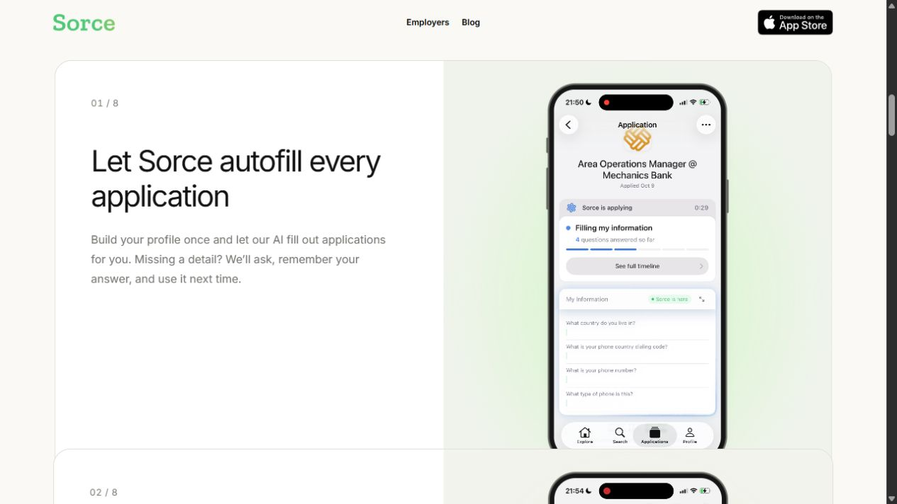
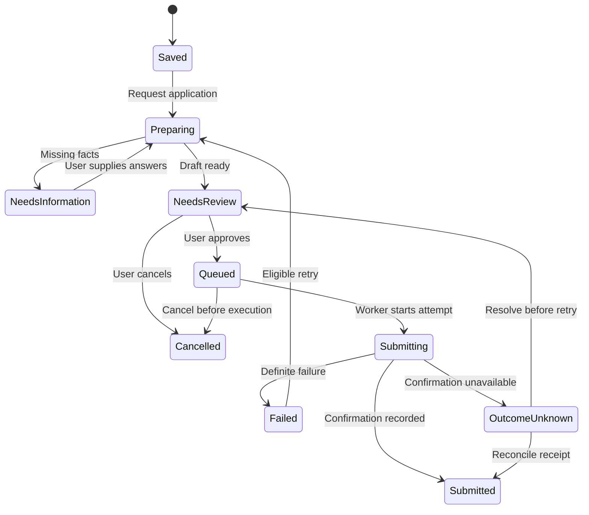

# Sorce findings and opportunities for NextStep

Research date: October 15, 2026. NextStep baseline: `23b9154df032e994685ac8f85ffef2bedd632873`.

**The most useful pattern to adopt is a reviewable, recoverable application workflow.** NextStep already has swipe cards, profile editing, resume analysis, job sourcing, and matching code. Its current auto-apply handler, however, only creates a database record. Building accurate application states, a durable tracker, and reviewed answers would close a more important gap than another swipe-interface redesign.

This public-surface investigation follows [Enrin's scope](../../../server/docs/SORCE_REVERSE_ENGINEERING_SCOPE.md). It combines live browser observations, REA analysis of captured website scripts, published product descriptions, and a static audit of NextStep. No account was created, resume supplied, application submitted, purchase made, or agreement accepted. Product code was not changed.

## What the evidence establishes

| Classification | Meaning in this report |
| --- | --- |
| Observed | A public page, link, screenshot, browser event, or code statement was directly inspected. An observed marketing statement is evidence of what Sorce says, not proof that its service performs it. |
| Derived | A conclusion follows from captured artifacts or inspected code, with its boundary stated. |
| Inferred | A design interpretation or proposed NextStep behavior; not recovered Sorce internals. |
| Unknown | Behavior requires authenticated/mobile access, additional capture, or live NextStep validation. |

The live homepage differs from the search-indexed page initially returned during research. The saved live page is authoritative for this pass's navigation and appearance. It sends job seekers to the iOS App Store and presents eight feature explanations. The phone screens and videos on that page are promotional previews, not a job-seeker session we operated. [Live homepage](https://www.sorce.jobs/), evidence E01–E02.

The image shows a recording embedded in Sorce's marketing page. It does not prove a real application was submitted during this investigation.

## Product patterns worth using

| Pattern | Public evidence from Sorce | What NextStep can use |
| --- | --- | --- |
| Reviewable profile and reusable answers | Homepage says missing details are requested and remembered. The tutorial describes resume upload, contact confirmation, and role/location/work-type/salary preferences. | Extend the existing extraction-and-review flow into a structured application profile, with approved facts, missing fields, and versioned resumes. |
| Review before submission | Live homepage explicitly offers pre-submission review. Apple release 4.5.0 describes the same capability. | Show the intended answers and selected documents before a submission request becomes executable. Preserve what the user approved. |
| Recovery when automation cannot proceed | FAQ describes manual fallback for unsupported forms. Release notes describe holds, follow-up questions, and correction/reapplication. | Add a needs-information queue, specific failure reasons, editable answers, retry rules, and a manual employer-site link. |
| Distinct discovery actions | Tutorial describes permanent skip; release notes describe bookmarks and pending cancellation. | Give save, skip, reject, request application, and cancel separate meanings. Persist decisions consistently and offer undo where it is possible. |
| Application progress that explains the next step | Public previews depict progress/timeline UI. Apple notes describe application cards and an inbox. | Store state history and confirmation evidence; let users distinguish saved, preparing, awaiting review, submitting, and submitted. |
| Focused discovery and company interest | Homepage describes personalized discovery, exact search, related jobs/companies, and company-follow alerts. | Reuse existing search/ranking and normalized job fields; add explicit preferences and understandable match reasons before adding more recommendation complexity. |

Sources: [homepage](https://www.sorce.jobs/), [tutorial](https://www.sorce.jobs/articles/sorce-tutorial), [FAQ](https://www.sorce.jobs/articles/sorce-faq), [Apple listing and version history](https://apps.apple.com/us/app/sorce-ai-job-search/id6504584959). See E01–E05 for captured page evidence. These are published capabilities, not a verified reconstruction of mobile behavior.

The public sources leave material details unsettled. The tutorial describes automatic submission after a swipe, while the homepage offers review; whether review is optional, default, or conditional remains unknown. Public pricing describes 40 daily swipes, while other descriptions use application credits and identify jobs that require no credit. The exact consumption, reset timezone, refund, and paid entitlement rules were not exercised. NextStep should define these rules explicitly rather than reproduce ambiguous terminology. [Tutorial](https://www.sorce.jobs/articles/sorce-tutorial), [pricing](https://www.sorce.jobs/articles/sorce-pricing), [Apple listing](https://apps.apple.com/us/app/sorce-ai-job-search/id6504584959), E03–E05.

## The current NextStep gaps

The [code audit](NEXTSTEP_CODE_AUDIT.md) includes source anchors and acceptance criteria. Its most consequential findings are:

1. **Auto-apply does not submit.** `/auto-apply` inserts an `Auto-Applied` MongoDB row and returns success. It does not use the supplied application URL, resume, or screening answers, and does not contact an employer. [Complete handler](../../../server/controllers/applicationsController.jsx#L280-L323).
2. **External applications can disappear from the tracker.** The application list requires matching local job and company records. External job snapshots are not saved, so those joins can discard the rows. [Tracker aggregation](../../../server/controllers/applicationsController.jsx#L97-L121).
3. **Apply has inconsistent meanings.** External Browse cards open an employer URL. Internal Browse cards pass too little data to their callback. The details page creates a local pending record. Right swipe uses the auto-apply stub. [Flow comparison](NEXTSTEP_CODE_AUDIT.md#apply-means-different-things-on-different-surfaces).
4. **Decisions and history are not durable enough.** Cards disappear before requests finish; saved rejections are not used by discovery; notes are only local React state. Withdrawal deletes a local record and cannot retract an employer application. [Swipe and tracker findings](NEXTSTEP_CODE_AUDIT.md#swipe-persistence-and-recovery).

These conclusions come from source inspection, not a production replay. The audit does not establish whether configured JSearch, database, authentication, or OpenAI services currently work.

## Recommended implementation order

| Priority | Change | Completion condition |
| --- | --- | --- |
| P0 | Correct application labels and unify the action contract | Saving/opening a link never claims submission; all card surfaces pass a full normalized job reference; existing local-only rows remain clearly identified. |
| P0 | Make tracking durable | Every request stores source ID, title, employer, application URL, timestamps, state history, and profile/resume version. External rows survive missing/expired source listings. Notes persist. |
| P1 | Review profile facts and application answers | Users can correct extracted information and review the proposed submission. Missing or uncertain answers create an actionable hold instead of invented qualifications. |
| P1 | Add one controlled submission adapter | A worker has explicit supported destinations, idempotency, attempt history, bounded retries, and a verifiable receipt. Validate with synthetic data against a test destination before a separately authorized live rollout. |
| P2 | Improve discovery and notifications | Saved/rejected decisions affect future results; useful filters and match explanations work; notifications point to persisted events that need attention. |

The following is a **proposed NextStep state model**, not Sorce's recovered implementation:

An uncertain network result must not immediately retry an external submission: the employer might already have received it. Keep the attempt identity and reconcile before allowing another attempt. Cancellation after execution begins needs its own supported behavior; deleting a tracker row is not employer withdrawal.

Reuse NextStep's React components, authenticated API shell, job normalization, profile review, and matching code. Write the application orchestration and records for NextStep's own contract. The investigation does not supply Sorce's private model prompts, ATS adapters, matching algorithm, backend source, or a reason to migrate NextStep to Next.js or Firebase.

## Public surfaces and technical findings

All seven non-root internal pages directly linked from the live homepage were captured: employer, blog, privacy, terms, security, FAQ, and case studies. The linked Apple page was captured, including its expanded version history; FAQ-linked tutorial, pricing, and download pages were also captured. Social/contact destinations were inventoried without contacting anyone. Secondary blog posts and the employer account/API product were not exhaustively traversed. [Page inventory](evidence/page-index.json), [homepage links](evidence/homepage-links.json).

REA 6.5.0 parsed **25 captured JavaScript files, totaling 1,023,950 UTF-8 bytes, with zero parse failures**. It recovered Webpack chunk/module relationships and static endpoint/storage candidates. Its application graph and semantic coverage are partial. The inspected marketing entry is chunk `405`; the shared layout includes Firebase initialization and analytics code. These do not establish the mobile app's architecture. [Technical findings](TECHNICAL_FINDINGS.md), E09–E12.

A browser reload capture recorded 81 request events and 81 response events, plus two failure events. It shows public assets and analytics traffic. No request URL containing `/api/` appeared in that window. This narrow observation does not prove the product lacks an API. Several REA endpoint candidates are actually generic `.get()` calls or framework code, so they were not promoted to backend endpoints. Runtime storage-key collection was unsupported; reported key names are static candidates only.

## Completion and remaining boundaries

This completes the **public-surface pass defined by Enrin's completion criteria**, with the acquisition substitution documented below. It does not complete authenticated or native-mobile reverse engineering.

| Scope requirement | Evidence and disposition |
| --- | --- |
| Marketing/navigation/resources/download entry points | Observed and inventoried: E01–E08; principal public pages have saved DOM evidence. |
| Onboarding/profile | Published flow documented: E03/E05. Actual authentication, required fields, resume processing, and permissions remain unobserved. |
| Job discovery | Public descriptions and promotional card previews documented: E01–E03/E05. Matching quality, filter enforcement, and actual swipe effects remain unobserved. |
| Application automation | Review, holds, failure recovery, and cancellation claims documented: E02–E05. Actual answers, submissions, confirmation receipts, and ATS coverage remain unknown. |
| Progress/account/limits | Public claims and privacy controls documented: E04–E06. Delivery, billing/credit enforcement, cancellation, and deletion execution remain unobserved. |
| Web scripts, relationships, endpoints, storage | Actual captured scripts analyzed by REA, with coverage limits: E09–E12. Mobile binaries, server code, and runtime storage contents were not inspected. |
| Useful NextStep conclusions | Code comparison and proposed sequence delivered: E13 and the code audit. No implementation changes were requested or made. |

**Acquisition substitution:** no REA MCP server was connected, and automatic approval review blocked the separate Chrome debugging-process launch. The supported in-app browser supplied scoped CDP script/network observations and page screenshots instead; REA's documented CLI fallback analyzed the exported script files. Thus `list_browser_targets`, `inspect_web_page`, `capture_web_screenshot`, and `analyze_web_bundle` were not successfully run as REA browser tools. No configuration, browser security setting, or approval policy was weakened. Evidence types and tool provenance are kept distinct in the [ledger](EVIDENCE_LEDGER.md).

A later mobile pass would need an authorized synthetic account/test resume and explicit boundaries for uploads, terms, permissions, and any external submission. Its questions are review defaults/editability, missing-answer handling, true state transitions, actual credit charging, receipts, notification consent, and account deletion. Those actions are outside the read-only scope of this pass.
